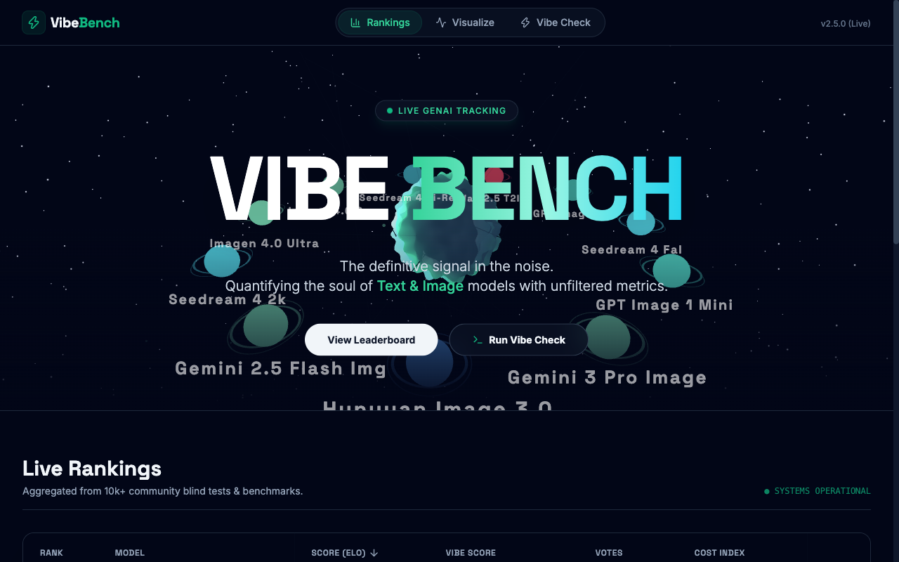
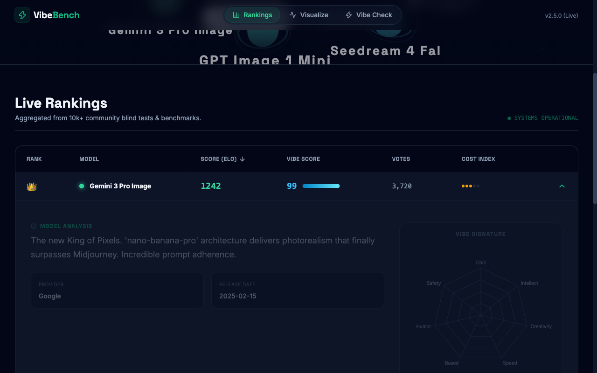
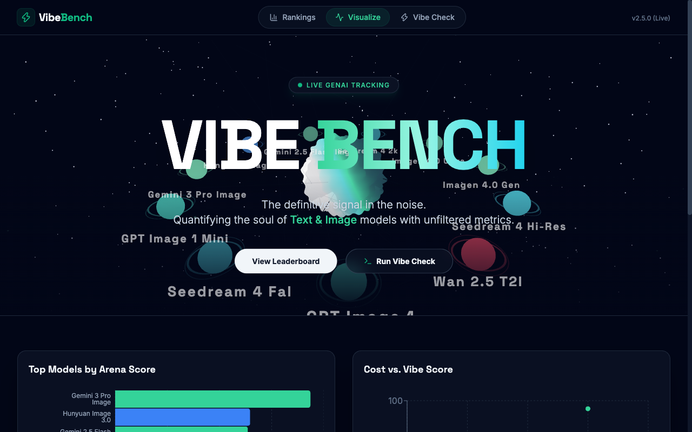

# ⚡ Vibe Bench

The definitive signal in the noise. A leaderboard that quantifies the *soul* of image generation models — not just accuracy, but aesthetics, prompt adherence, creative flair, and raw basedness.

## Quick Start

```bash
git clone https://github.com/andrewvoirol/ais-vibe-bench.git
cd ais-vibe-bench
npm install
npm run dev
```

Open [http://localhost:3000](http://localhost:3000).

> **Optional:** To use the Vibe Check judge, copy `.env.example` to `.env.local` and add your [Gemini API key](https://aistudio.google.com/apikey).

## What It Does

**Rankings** — Sortable leaderboard of 11 image-gen models (Gemini, Imagen, GPT Image, Seedream, Hunyuan, Wan) ranked by ELO score and Vibe Score. Click any row to see detailed attributes and a radar chart "Vibe Signature".



**Visualize** — Interactive charts: ELO bar chart by provider, Cost vs. Vibe Score scatter plot, and a methodology explainer.



**Vibe Check** — Paste any prompt, hit Execute, and Gemini 2.5 Flash rates the response across 6 axes (Chill, Intellect, Creativity, Basedness, Humor, Safety) with a punchy Judge's Reasoning.

## How It Works

Type a prompt in the terminal-styled input. The app sends it to Gemini 2.5 Flash with a structured JSON schema that forces scores on 6 vibe axes. Results render in a cyberpunk output panel with metric boxes and a scrollable model output stream.

The 3D hero uses React Three Fiber — a central "Singularity Core" (noise-displaced icosahedron with custom GLSL shaders) orbited by model planets with hover-reveal stat cards, backed by 1000 instanced particles and random connection lines.

## Tech Stack

| Layer | Technology |
|---|---|
| Framework | React 19 + Vite |
| 3D | Three.js, React Three Fiber, Drei |
| Charts | Recharts |
| Styling | Tailwind CSS 3 |
| AI | Gemini 2.5 Flash via `@google/genai` |
| Icons | Lucide React |
| Fonts | Space Grotesk, Inter (Google Fonts) |

## License

MIT
